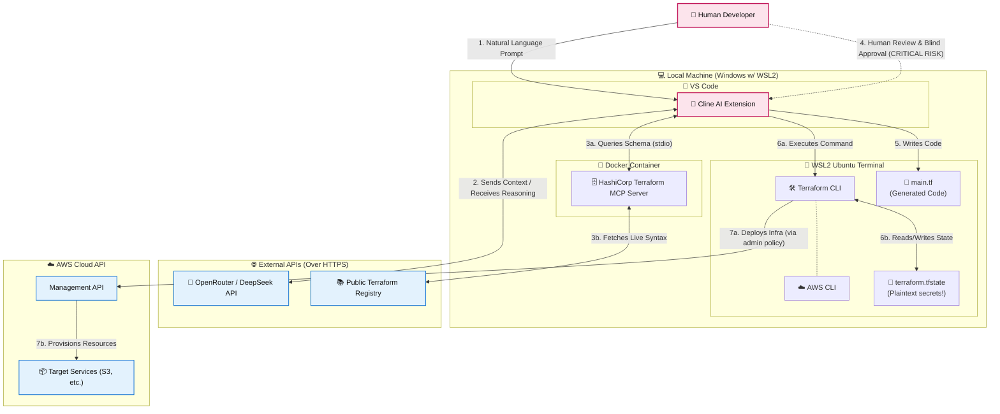

# terraform-ai-cloud-agent

**AI-assisted Infrastructure as Code portfolio repository** — a curated, multi-folder collection of
Terraform configurations for AWS built with a human-plus-AI workflow.

When I first started exploring Infrastructure as Code (IaC) with Terraform alongside AI coding assistants, I ran into a wall of common beginner anxieties: *How do I stop an AI from leaking my AWS credentials? How do I keep it from hallucinating deprecated Terraform syntax? And how can I build cloud resources without accidentally blowing past the AWS Free Tier budget?*

This repository is the result of solving those exact problems. It is a modular, guardrailed, human-in-the-loop framework designed to let AI coding agents build production-grade cloud infrastructure safely, cheaply, and accurately.

## The Journey & Architectural Evolution

Instead of treating AI tools like a simple copy-paste chatbot, I wanted to build a disciplined agentic workflow that mimics how professional cloud engineers operate:

1. **Solving the Credential Leak Risk**
   Early on, I realized storing long-lived plaintext keys or letting an AI scan local configuration files posed massive security risks. I structured the environment to rely purely on environment variables or external shared credential chains, ensuring zero secrets ever touch the codebase or enter an LLM context window.

2. **Stopping AI Hallucinations with MCP**
   Standard LLMs often guess Terraform arguments based on outdated training data (like using deprecated inline `acl` or `versioning` blocks on S3 buckets). To fix this, I integrated the official **HashiCorp Terraform MCP Server** running locally in Docker. This allows the AI agent to query the live Terraform registry for real-time schemas *before* writing a single line of code.

3. **Balancing Cost and Intelligence**
   Running high-end proprietary models can become expensive quickly. By routing lightweight, high-performance open-source models (like DeepSeek via OpenRouter) through an IDE agent (Cline in VS Code), I achieved top-tier coding intelligence at a fraction of a cent per prompt.

---

## Core Guardrails (`.clinerules`)

To ensure the AI assistant never behaves unpredictably, every task in this repository is bound by strict guardrails defined in `.clinerules`:

* **Live Schema Verification**
  The agent must query the Terraform MCP server before writing any resource block.
* **Cost Protection**
  Defaults are strictly tied to AWS Free Tier parameters (e.g., `t3.micro` instances, `PAY_PER_REQUEST` billing) unless explicitly overridden.
* **Security-First Design**
  No hardcoded profile names, account IDs, or credentials allowed in `.tf` files.
* **Modular Cleanliness**
  Infrastructure is split cleanly into `main.tf`, `variables.tf`, and `outputs.tf`, with mandatory post-generation validation (`terraform fmt` and `terraform validate`).

---



## Repository Layout

```
terraform-ai-cloud-agent/
├── .clinerules                  # Agent guardrails (read by the AI assistant)
├── .gitignore                   # Standard Terraform ignores (.tfstate, .terraform, *.tfvars, ...)
├── mcp-config.example.json      # Template enabling the Terraform MCP Server in your IDE
├── README.md                    # This file
├── modules/
│   └── s3-bucket/               # Reusable private S3 bucket module
│       ├── main.tf              #   random_id + aws_s3_bucket + aws_s3_bucket_public_access_block
│       ├── variables.tf         #   bucket_prefix, force_destroy, tags
│       └── outputs.tf           #   bucket_id, bucket_arn, bucket_regional_domain_name
└── examples/
    ├── 01-ec2-web-server/       # Example 01: Ubuntu 24.04 EC2 instance (t3.micro, Free Tier)
    │   ├── main.tf              #   provider + SSM AMI lookup + aws_instance
    │   ├── variables.tf         #   region, profile (null default), instance_type, tags
    │   ├── outputs.tf           #   instance_id, instance_arn, instance_public_ip
    │   └── terraform.tfvars.example
    └── 02-s3-private-bucket/    # Example 02: consumes the s3-bucket module
        ├── main.tf              #   provider + module call (source = ../../modules/s3-bucket)
        ├── variables.tf
        ├── outputs.tf
        └── terraform.tfvars.example
```

## The AI-Assisted IaC Workflow

### 1. Enable the Terraform MCP Server

The [Terraform MCP Server](https://developer.hashicorp.com/terraform/registry) gives the AI
assistant live, schema-accurate documentation straight from the HashiCorp registry — so it never
relies on memory for arguments and never emits deprecated syntax.

1. Copy `mcp-config.example.json` to `.vscode/.mcp.json` (or your IDE's MCP config):

   ```bash
   cp mcp-config.example.json .vscode/.mcp.json
   ```

   The template looks like this:

   ```json
   {
     "mcpServers": {
       "terraform": {
         "command": "docker",
         "args": ["run", "-i", "--rm", "hashicorp/terraform-mcp-server"]
       }
     }
   }
   ```

2. Ensure Docker is installed and running — the server is launched as
   `docker run -i --rm hashicorp/terraform-mcp-server`.
3. Restart/reload your IDE workspace so the MCP server connects.

### 2. The Authoring Loop (per task)

Every task in this repository follows the same loop — this is the core of the "AI-assisted" process:

1. **Schema verification (guardrail #1).** Before writing *any* resource block, the agent queries the
   Terraform MCP Server for the current schema of the resources it plans to use (e.g. `aws_s3_bucket`,
   `aws_s3_bucket_public_access_block`, `aws_instance`, the `aws_ssm_parameter` data source). This is
   how we know, for example, that `acl`, `cors_rule`, and `versioning` blocks on `aws_s3_bucket` are
   **deprecated** and belong in dedicated sub-resources such as `aws_s3_bucket_acl` and
   `aws_s3_bucket_versioning`.

2. **Cost protection (guardrail #2).** Defaults are always Free Tier eligible: `t3.micro` instances,
   `PAY_PER_REQUEST` DynamoDB billing, standard S3 storage class. Overrides require an explicit
   instruction.

3. **Security first (guardrail #3).** No AWS credentials, profile names, or account IDs ever appear
   in `.tf` files. Identity is supplied via variables or the standard environment / shared-credential
   chain (e.g. `AWS_PROFILE`). Notice that every example declares `aws_profile` with a `null` default.

4. **S3 & network safety (guardrail #4).** Every S3 bucket is accompanied by an
   `aws_s3_bucket_public_access_block` resource with all four settings set to `true` — private by
   default, every time.

5. **Code structure & validation (guardrail #5).** Code is separated into `main.tf`, `variables.tf`,
   and `outputs.tf`. Before the task is considered done, the agent runs:

   ```bash
   terraform fmt
   terraform validate
   ```

### 3. Human-in-the-Loop Review

The AI drafts; the human reviews. Never run `terraform apply` without first reviewing the output of
`terraform plan` in a directory with real (non-demo) infrastructure. `terraform destroy` is the
cleanup tool — the examples here are designed to be destroyed when you are done experimenting.

---

## Prerequisites

- [Terraform](https://developer.hashicorp.com/terraform/downloads) `>= 1.5` (built against 1.17.x)
- AWS credentials with permissions to create the resources in the example you run (EC2 + SSM, or S3)
- Docker (only needed for the MCP server)

### Configure AWS

Pick one — never edit the `.tf` files to inject credentials (guardrail #3):

```bash
# Option A - environment variable
export AWS_PROFILE=your-profile

# Option B - terraform.tfvars (gitignored)
cp examples/02-s3-private-bucket/terraform.tfvars.example \
   examples/02-s3-private-bucket/terraform.tfvars
# then edit terraform.tfvars and uncomment/set aws_profile
```

---

## Running the Examples

Each example is an independent root configuration, so the commands are the same inside each folder.

### Example 01 — EC2 Web Server

```bash
cd examples/01-ec2-web-server

terraform init          # installs hashicorp/aws from the registry
terraform fmt -check    # guardrail #5 - formatting
terraform validate      # guardrail #5 - static validation
terraform plan          # preview (resolves the latest Ubuntu 24.04 AMI via SSM)
terraform apply         # create the t3.micro instance (review the plan and approve)
```

Expected outputs after apply:

```hcl
instance_arn        = "arn:aws:ec2:ap-south-2:123456789012:instance/i-..."
instance_id         = "i-..."
instance_public_ip  = "13.x.x.x"
```

Cleanup:

```bash
terraform destroy -auto-approve
```

### Example 02 — Private S3 Bucket

```bash
cd examples/02-s3-private-bucket

terraform init
terraform fmt -check
terraform validate
terraform plan
terraform apply
```

Expected outputs after apply:

```hcl
bucket_arn    = "arn:aws:s3:::workshop-private-<random-hex>"
bucket_domain = "<name>.s3.ap-south-2.amazonaws.com"
bucket_name   = "workshop-private-<random-hex>"
```

Verify privacy in the AWS Console (S3 → bucket → Permissions): the **Block public access** panel
should show all four settings `ON` at the bucket level, matching guardrail #4:

| Setting                       | Value |
|-------------------------------|-------|
| Block all public access       | ON    |
| Block public ACLs             | ON    |
| Block public bucket policies  | ON    |
| Ignore public ACLs            | ON    |
| Restrict public bucket policies | ON   |

Cleanup:

```bash
terraform destroy -auto-approve
```

---

## Using the `s3-bucket` Module Elsewhere

The module is reusable from any root configuration:

```hcl
module "data_bucket" {
  source = "git@github.com:you/terraform-ai-cloud-agent//modules/s3-bucket"
  # or a local path:
  # source = "../../modules/s3-bucket"

  bucket_prefix = "our-private"
  force_destroy = true   # allow the bucket to be deleted with objects on terraform destroy
  tags = {
    Environment = "dev"
  }
}
```

Because the module has no provider / `region` / `profile` settings, it always inherits them from the
calling root — the correct, secure default for reusable components.

---

## Security Notes

- **Nothing sensitive is committed.** `.gitignore` excludes `*.tfvars`, `*.tfstate*`, `.terraform/`,
  `.terraformrc`, and `terraform.rc`. The only checked-in variable files are the `*.example`
  templates with placeholder values.
- **No hardcoded identity.** Every example reads `aws_region` / `aws_profile` from variables with
  `aws_profile` defaulting to `null`; modules contain neither.
- **Private by default.** Every bucket is locked down via `aws_s3_bucket_public_access_block` with
  all four settings `true` (guardrail #4).
- **Free Tier conscious.** EC2 uses `t3.micro` (guardrail #2); DynamoDB examples should use
  `PAY_PER_REQUEST`; S3 uses the standard storage class. Always `terraform destroy` after use.

---

## Guardrails (`.clinerules`)

1. **Schema Verification:** always query the HashiCorp Terraform MCP Server before writing resource
   blocks to avoid deprecated arguments.
2. **Cost Protection:** default to AWS Free Tier eligible resources (`t3.micro`, `PAY_PER_REQUEST`,
   standard S3) unless explicitly instructed otherwise.
3. **Security First:** never hardcode AWS credentials, profile names, or account IDs. Always use
   variables or environment variables.
4. **S3 & Network Safety:** all S3 buckets must enforce `aws_s3_bucket_public_access_block` with all
   four settings set to `true`.
5. **Code Structure:** separate code cleanly into `main.tf`, `variables.tf`, and `outputs.tf`, and
   run `terraform fmt` and `terraform validate` before finishing any task.

